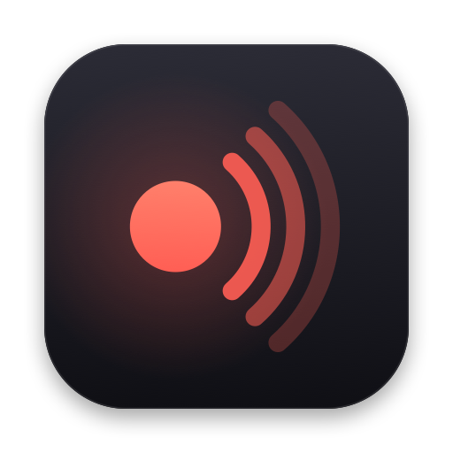

<p align="center"></p>

# 余音 Yuyin（语音转写）

中文语音转写客户端，支持 **iOS + macOS**：实时字幕先上屏，每句话停顿后用更准的模型重新识别定稿（2-pass）。模式可选 **纯离线 / 混合 / 纯云端**，支持多人识别、实时翻译，以及录制腾讯会议等会议软件、网页和其他 App 的声音（macOS）。

v0.2 重新设计说明（含 v0.1 审查结论）：[`docs/plans/2026-10-11-v0.2-redesign.md`](docs/plans/2026-10-11-v0.2-redesign.md)
最初设计文档：[`docs/plans/2026-10-11-ios-macos-asr-client-design.md`](docs/plans/2026-10-11-ios-macos-asr-client-design.md)

## 功能

| 能力 | 实现 |
|------|------|
| 实时字幕 | [sherpa-onnx](https://github.com/k2-fsa/sherpa-onnx) 流式 Zipformer；未装模型时用系统**本机**语音识别 |
| 句末纠错 | **Fun-ASR-Nano**（macOS 推荐，中文 / 英文 / 中英混说实测最准）/ Paraformer-large + 中文标点（纯中文，英文句自动交给 SenseVoice）/ SenseVoice（Sherpa 或 [FluidAudio](https://github.com/FluidInference/FluidAudio) 神经网络引擎）/ FireRedASR / Fun-ASR-Nano / Qwen3-ASR；大模型输出有防幻觉过滤 |
| 云端 | 阿里云百炼 Fun-ASR：实时 WebSocket + 句级同步 HTTP；混合模式失败时回退本机 |
| 断句 | 连续切分的自适应 VAD（不丢音频）；话没说完的短句等更久的停顿，流式句末需有静音佐证；逐句音量归一化 |
| 记录 | 每次录音保存转写和 16 kHz 录音，录音过程中自动存盘，崩溃后可恢复 |
| 首页 | 横条：开始录音 · 录音记录 · 设置；实时字幕、录音记录、设置都是从横条向下展开的卡片（macOS 悬浮在最前，不抢焦点） |
| 音源 | 麦克风 / 系统声音 / 指定应用 / 会议（麦克风 + 系统声音，回声消除）；macOS 14.2+，基于 Core Audio Process Tap |
| 多人 | 每句自动标注说话人（CAM++ 声纹，只用人声部分；在 AMI 会议语料上准确率约 90%～96%）；录音中点名字即可命名，同名自动合并，可把某句改给别人；旧录音可用「重新分析说话人」按新模型重新标注，名字保留 |
| 翻译 | 每句定稿后翻译（中⇄英自动，或指定目标语言）；系统离线翻译（macOS 26 / iOS 26）或通义千问 MT（云端） |
| 导出 | 录音结束后直接导出；txt / SRT / Markdown 文件，含说话人名字，可选包含译文；复制全文 |
| 隐私 | 纯离线模式不联网；API Key 存放在钥匙串 |

## 快速开始

```bash
python3 scripts/generate_xcodeproj.py   # 增删 App 源文件后需要重新生成
open Yuyin.xcodeproj
```

首次打开时 Xcode 会通过 SPM 拉取 `sherpa-onnx`（含 onnxruntime）和 `FluidAudio`，体积较大。

命令行构建：

```bash
# macOS
xcodebuild -project Yuyin.xcodeproj -scheme Yuyin-macOS -configuration Debug \
  -derivedDataPath build/DerivedData CODE_SIGNING_ALLOWED=NO build
open build/DerivedData/Build/Products/Debug/Yuyin.app

# iOS 模拟器
xcodebuild -project Yuyin.xcodeproj -scheme Yuyin-iOS -configuration Debug \
  -destination 'generic/platform=iOS Simulator' \
  -derivedDataPath build/DerivedData CODE_SIGNING_ALLOWED=NO build
```

## 使用

1. **设置 → 模型**：下载「流式 Zipformer」和「Fun-ASR-Nano（推荐）」（约 800 MB）；想省空间可选「Paraformer-large 中文」（会自动带上标点模型）。多人识别再下载「说话人声纹」（CAM++，约 28 MB）。
2. 点横条上「开始录音」下方的「麦克风 · 纯离线」选择音源和模式：录会议选「会议」或「系统声音」，只录某个 App 选「指定应用」。首次录系统声音时 macOS 会请求「录制系统音频」权限。
3. 点「开始录音」（⌘R）。横条下方显示最新两句：上一句变暗，当前句较大；正在听的句子标「识别中」，字色稍暗，定稿后变亮；蓝色是译文。点「展开」可查看完整的实时会议记录。点说话人名字可以命名，或更正这句的说话人。
4. 点「结束」后会等最后几句纠错、翻译完成再保存，横条下方出现「已保存」卡片，可以直接导出或查看记录。
5. 「录音记录」（⌘L）里可以搜索、重命名、给说话人改名、重新分析说话人、导出。

识别评测（开发用）：`YUYIN_EVAL_WAV=<某条记录的 audio.wav> swift test --filter EvaluationTests` 可以在真实录音上对比各模型（见 `Packages/YuyinLocal/Tests/YuyinLocalTests/EvaluationTests.swift`）。

混合 / 纯云端模式和云端翻译需要在 **设置 → 云端** 填写百炼 API Key。系统离线翻译需要先在 **设置 → 实时翻译** 下载语言。

> iOS 不允许录制其他 App 的声音，iPhone / iPad 上只能用麦克风。

也可以用脚本下载模型：`bash Models/download.sh [--with-firered]`。未沙盒的开发版会直接读取；签名（沙盒）版请在设置里用「导入已下载的模型文件夹…」导入。

## 测试

```bash
(cd Packages/YuyinCore && swift test)
(cd Packages/YuyinCloud && swift test)
(cd Packages/YuyinLocal && swift test)   # 若本机已装模型，会额外跑真实模型集成测试
```

YuyinCore 与 YuyinCloud 只依赖 Foundation，也可以在 Linux（Swift 6 工具链）上运行 `swift test`。

人工验收清单：[`docs/MANUAL_TEST.md`](docs/MANUAL_TEST.md)

## 仓库结构

```
Apps/Yuyin/Sources/   SwiftUI App：Recorder、AudioCapture、各页面
Packages/YuyinCore/   会话（VAD 断句 + 串行纠错）、存储、导出、设置 / 钥匙串
Packages/YuyinLocal/  sherpa-onnx / FluidAudio / Apple Speech 引擎，模型下载与导入
Packages/YuyinCloud/  Fun-ASR 实时与句级纠错
Models/download.sh    模型下载脚本
docs/                 设计文档与测试清单
```

## 依赖

| 依赖 | 用途 |
|------|------|
| sherpa-onnx | 流式 Zipformer；离线 SenseVoice / Paraformer / FireRed；说话人模型 |
| FluidAudio | SenseVoice CoreML（神经网络引擎） |
| Apple Speech | 未装模型时的本机回退（强制本机识别） |
| 阿里云百炼 Fun-ASR | 混合 / 云端模式 |
| 通义千问 MT | 云端翻译 |
| Apple Translation | 系统离线翻译 |
| Core Audio Process Tap | 录制会议软件 / 网页 / 其他 App 的声音（macOS） |

第三方引擎、模型与云服务分别遵循各自的许可和服务条款。

## 许可

本项目以 [MIT 许可证](LICENSE) 开源。sherpa-onnx 与 FluidAudio 为 Apache-2.0；各模型的许可以其发布页为准，云服务遵循各自的服务条款。
